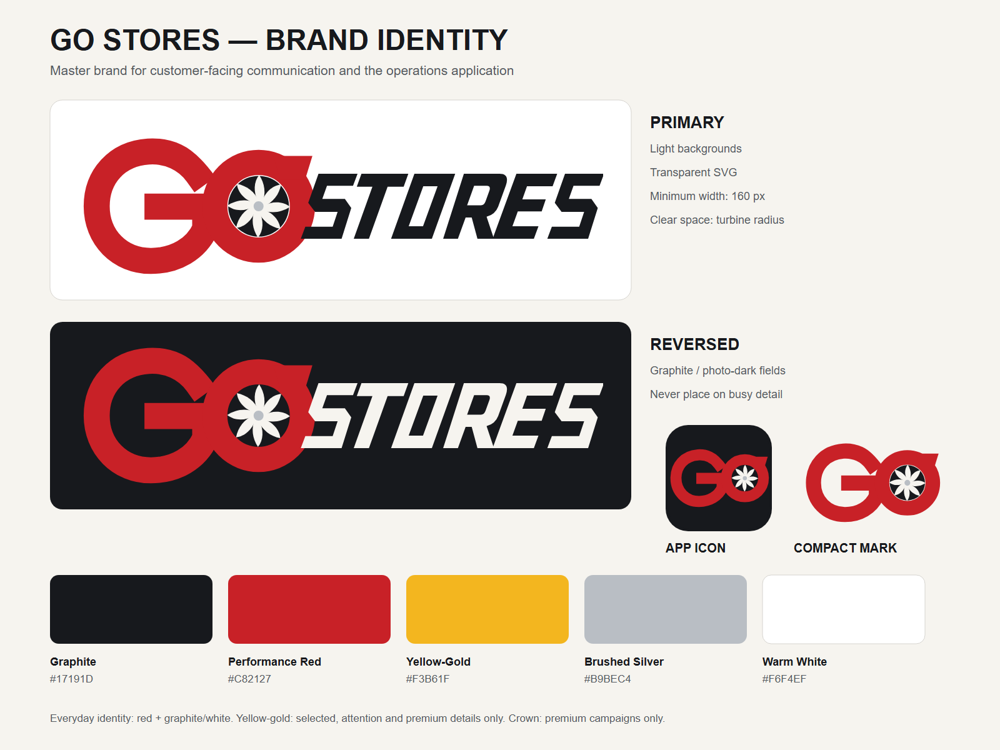
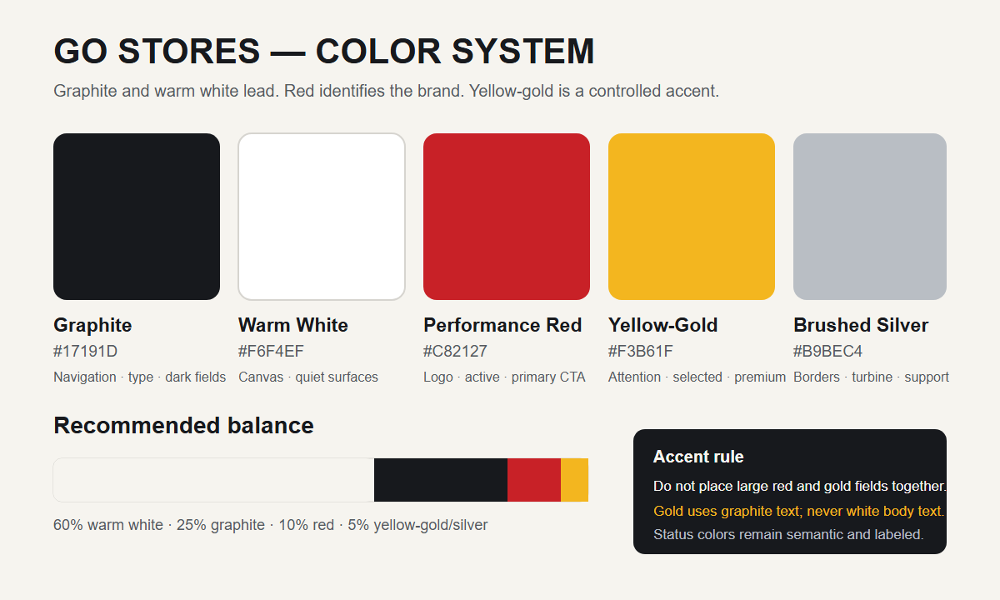

# GO Stores brand identity package

**Prepared:** 22 November 2026  
**Status:** proposed vector identity based on the customer-facing references supplied by the user. Obtain Maher/brand-owner approval and, if available, compare against the original trademark/vector artwork before declaring it the official master.

This is the usable identity package that the earlier concept board did not provide. The logo artwork is deterministic SVG, with no font dependency in the wordmark. Transparent PNG exports are included for presentations and ordinary office use. Nothing in this package is imported by the application yet.

## Identity overview

Open the scalable version: [brand-sheet.svg](brand-sheet.svg).

## Logo assets

| Use | Vector master | Transparent PNG |
|---|---|---|
| Primary logo on light backgrounds | [logo-primary.svg](assets/logo-primary.svg) | [logo-primary.png](assets/logo-primary.png) |
| Reversed logo on graphite/dark backgrounds | [logo-reversed.svg](assets/logo-reversed.svg) | [logo-reversed.png](assets/logo-reversed.png) |
| One-color dark | [logo-mono-dark.svg](assets/logo-mono-dark.svg) | [logo-mono-dark.png](assets/logo-mono-dark.png) |
| One-color light | [logo-mono-light.svg](assets/logo-mono-light.svg) | [logo-mono-light.png](assets/logo-mono-light.png) |
| Compact GO turbine mark | [mark-primary.svg](assets/mark-primary.svg) | [mark-primary.png](assets/mark-primary.png) |
| Application icon | [app-icon.svg](assets/app-icon.svg) | [app-icon.png](assets/app-icon.png) |
| Browser/favicon source | [favicon.svg](assets/favicon.svg) | [favicon.png](assets/favicon.png) |
| Premium campaign lockup | [premium-lockup.svg](assets/premium-lockup.svg) | [premium-lockup.png](assets/premium-lockup.png) |

The premium crown is not part of the everyday master logo. The transformer/robot is not a logo element or application mascot.

## Palette

| Role | Color | Hex | Recommended use |
|---|---|---|---|
| Foundation | Graphite | `#17191D` | Navigation, headings, dark fields, reversed-logo background |
| Foundation | Warm White | `#F6F4EF` | Application canvas and quiet backgrounds |
| Surface | White | `#FFFFFF` | Cards, forms, tables and documents |
| Primary brand | Performance Red | `#C82127` | Logo, active marker, sparing primary actions |
| Primary dark | Deep Red | `#98171B` | Pressed/hover state and small dark-brand details |
| Accent | Yellow-Gold | `#F3B61F` | Selection, attention, focus detail and premium emphasis |
| Accent dark | Bronze Gold | `#A86F00` | Gold text/border where greater contrast is required |
| Support | Brushed Silver | `#B9BEC4` | Turbine, technical borders and secondary detail |
| Line | Warm Gray | `#D6D4CF` | Dividers and neutral borders |
| Muted text | Neutral Gray | `#676B70` | Secondary copy on white/warm-white surfaces |

Recommended visual balance: **60% warm white, 25% graphite, 10% red, 5% yellow-gold/silver**.

Do not use white text on yellow-gold; its contrast is only 1.82:1. Use graphite on gold (9.66:1). White on red is 5.67:1, red on warm white is 5.16:1, and graphite on warm white is 16.01:1.

## Application scheme

| Element | Treatment |
|---|---|
| Page canvas | Warm white `#F6F4EF` |
| Cards and data surfaces | White `#FFFFFF`, warm-gray border |
| Sidebar/mobile chrome | Graphite `#17191D` |
| Active navigation | Warm-white selection surface plus a slim red marker |
| Primary button | Performance red with white text |
| Secondary button | White with graphite text and silver/warm-gray border |
| Keyboard focus | Gold outline with sufficient graphite separation |
| Selected/in-progress | Pale gold surface, graphite text and an explicit label/icon |
| Premium package | Gold detail on graphite; never a large red-and-gold competition |
| Danger/warning/success/info | Use separate semantic colors from `brand-tokens.css`; do not redefine every red as danger or every gold as warning |

Reference tokens are available as [CSS](brand-tokens.css) and [JSON](brand-tokens.json). They are documentation only and have not been added to the running application.

## Typography

- Product UI Latin: **IBM Plex Sans**.
- Product UI Arabic: **IBM Plex Sans Arabic**.
- Logo wordmark: custom outlined geometry in the SVG; no font installation required.
- Use sentence case for operational labels. Reserve all-caps styling for the brand, small eyebrows, reference numbers and compact status vocabulary.
- Do not substitute an aggressive Latin display font for Arabic interface text.

## Logo rules

- Clear space on every side: at least the radius of the turbine hub shown inside the O.
- Minimum primary-logo width: 160 px for screen, 35 mm for print.
- Below 160 px, use the compact mark; below 32 px, use the favicon/turbine source.
- Use primary on white/warm white and reversed on graphite or sufficiently quiet dark imagery.
- Use monochrome only when color reproduction is unavailable.
- Do not stretch, rotate, recolor individual letters, replace the turbine, add shadows/bevels, add the crown to the everyday mark, or place the mark over busy imagery.
- Do not combine large red and yellow-gold areas. One should lead; the other should appear as a small accent.

## Approval checklist

Before application adoption:

1. Maher confirms the cleaned mark matches the intended current GO Stores identity.
2. Compare it with any original AI/EPS/SVG/PDF trademark artwork and replace this reconstruction if an authoritative vector exists.
3. Confirm whether the crown and premium lockup are permitted campaign assets.
4. Confirm Arabic/English brand naming and any required registered-mark placement.
5. Approve the palette and color-production references for screen and print.
6. Only then create an implementation plan for the application shell, login, print documents and visual regression baselines.

No application code, existing public assets, or runtime settings were modified.
