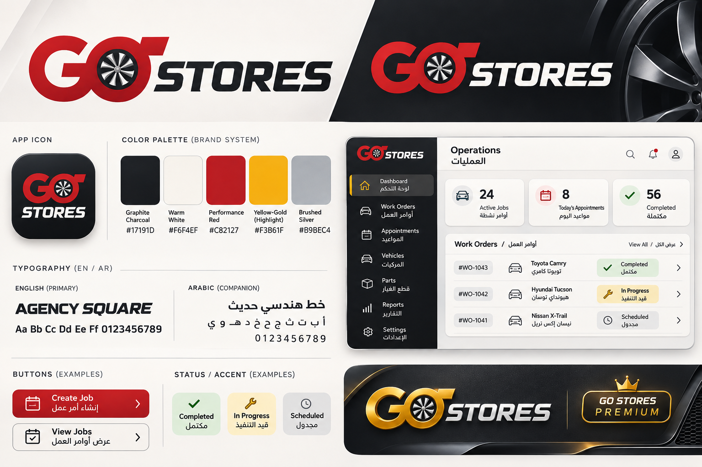
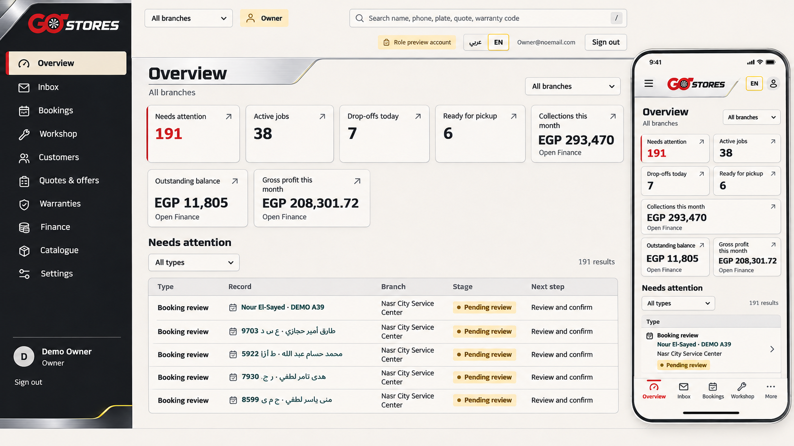
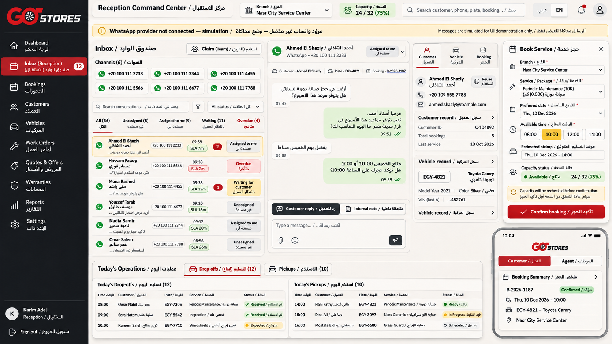
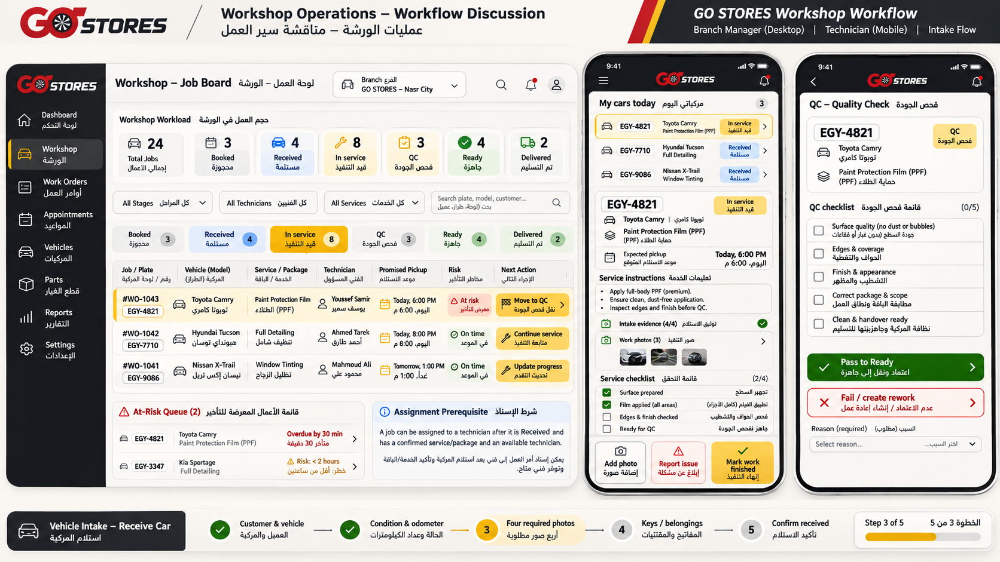
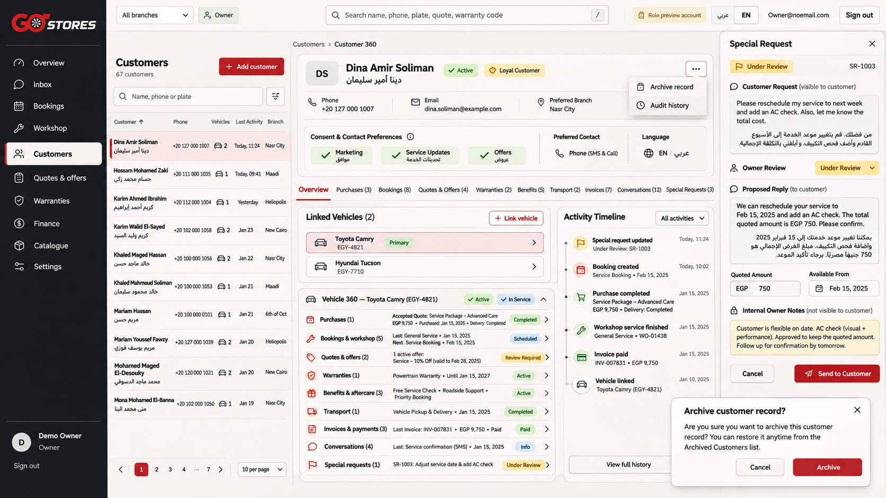
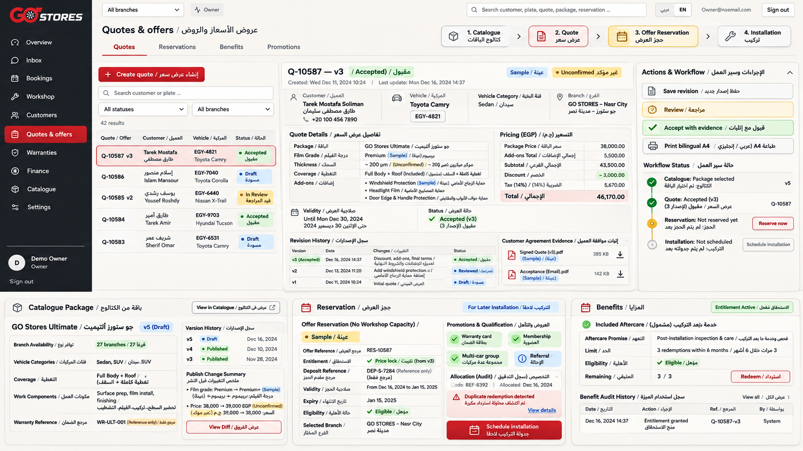
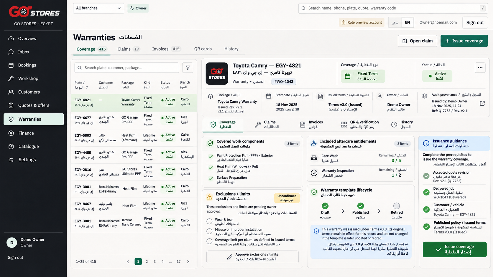
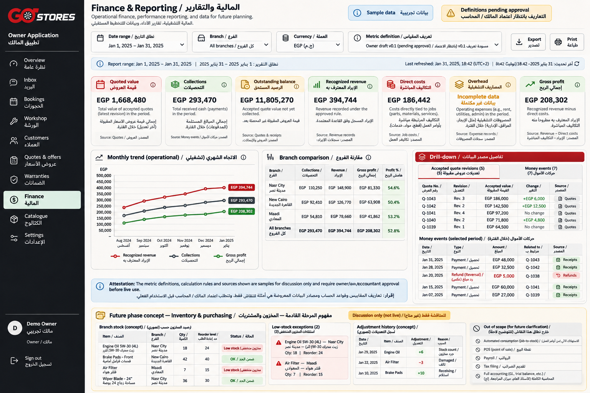
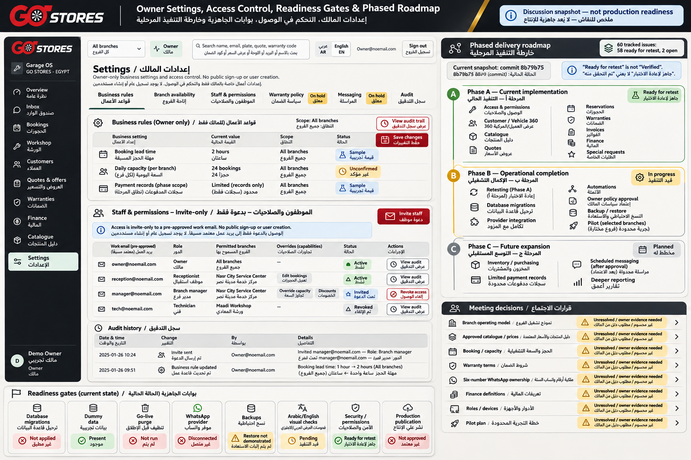

# GO Stores product visual suite

**Prepared:** 22 November 2026  
**Repository snapshot:** `8b79b750aa028ec5fcb0d77e6772724e573a522b`  
**Purpose:** discussion material for Maher; not an implementation record or production-readiness claim.

This package turns the accepted GO Stores operational-product direction into a coherent visual walkthrough. It combines implemented capabilities, items that are implemented but still need retesting, owner decisions that remain unresolved, and explicitly labelled future concepts.

The boards are generated design concepts. Small text and Arabic copy must be proofread before external publication. They are not pixel specifications and do not establish that a depicted workflow is live, verified, connected to WhatsApp, migrated, or approved as business policy.

## Status legend

- **Current / ready for retest:** source exists in the referenced repository snapshot, but the tracker does not record a runtime retest.
- **Discussion concept:** accepted product direction or a useful UX representation that still needs implementation planning or business confirmation.
- **Future phase:** intentionally outside the currently implemented operational surface.
- **Unresolved:** requires Maher, the owner, an accountant, a supplier, legal review, or provider configuration.

The Phase 1 tracker currently contains 60 issues: 58 are **Ready for retest** and P1-030/P1-031 remain **Open**. Ready for retest is not Verified. Migrations `0026`-`0030` and `0032`, the bilingual seed, and the go-live purge have not been run in a verified target environment.

## Recommended presentation order

### 1. Customer-facing identity extended into the product

Use this board to agree that GO Stores is the master brand. Graphite and warm white carry the interface; red carries recognition and primary brand emphasis; yellow-gold is controlled attention/premium emphasis; silver supports the automotive/technical character. The transformer remains a social-content character and is not part of the core product identity.

### 2. Owner overview

Demonstrates the existing owner information architecture with the proposed brand system. Discuss which exceptions Maher needs first, which financial definitions are trusted, and which drill-downs should be one click away.

### 3. Reception, central inbox, booking, and transport context

Demonstrates the accepted six-number central-team model, source-channel retention, conversation ownership, customer/vehicle reuse, capacity-aware booking, and truthful provider-disconnected state. The specific phone numbers and customer data are fictional.

### 4. Workshop, technician mobile, intake, and QC

Demonstrates stage-based work, visible assignment prerequisites, sequential intake, evidence, technician next actions, and QC pass/fail with rework. It deliberately avoids technician scoring and drag-and-drop as the primary control.

### 5. Customer and Vehicle 360

Demonstrates one connected history for purchases, bookings, workshop work, offers, warranties, benefits, transport, invoices, conversations, and special requests. Customer-visible replies and internal owner notes remain separate.

### 6. Catalogue, quotes, promotions, reservations, and benefits

Demonstrates a versioned package and quote, accepted-revision evidence, later-installation reservation without consuming workshop capacity, promotion qualification, duplicate-redemption protection, and included-benefit redemption. All prices and terms shown are samples, not owner-approved policy.

### 7. Warranty and aftercare

Demonstrates contextual warranty work, fixed-term and lifetime semantics, issued-term history, aftercare entitlements, issuance prerequisites, claims, invoice/QR tabs, and privacy-safe public verification. The generated board focuses on the coverage tab; claims, invoices, QR and history remain part of the discussion scope.

### 8. Finance, reporting, and future inventory

Demonstrates the required separation of quoted value, collections, balance, recognized revenue, direct cost, overhead, and gross profit. Metric definitions and sample data are visibly provisional. Inventory and purchasing are marked as a future-phase concept rather than a live module.

### 9. Owner settings, access, readiness, and roadmap

Demonstrates invite-only access, role/branch scope, capability overrides, auditable settings, on-hold policy areas, migration/provider/backup/pilot gates, and the boundary between current implementation, operational completion, and future expansion.

## What these visuals do not approve

- Current prices, taxes, discounts, deposit/refund rules, promotion limits, or referral eligibility.
- Warranty wording, lifetime meaning, exclusions, remedies, or transferability.
- Branch roster, working hours, staff accounts, permissions, capacity, or calendars.
- Live WhatsApp numbers, provider credentials, template approval, message delivery, or scheduled messaging.
- Financial recognition rules or accounting treatment.
- Production deployment, data migration, backup/restore readiness, or go-live.

## Package contents

- [Discussion guide](DISCUSSION_GUIDE.md) — a focused walkthrough and decision-capture agenda for Maher.
- [Traceability matrix](TRACEABILITY.md) — visual-to-requirement, tracker, code, and update-location mapping.
- [Planning handoff](PLANNING_HANDOFF.md) — workstreams, refresh procedure after concurrent changes, and inputs for the later implementation plan.
- [Generation prompts](PROMPTS.md) — the final shared prompt and board-by-board specifications used with the built-in image-generation tool.

No application source, runtime settings, database data, migrations, or integrations were changed to create this package.
