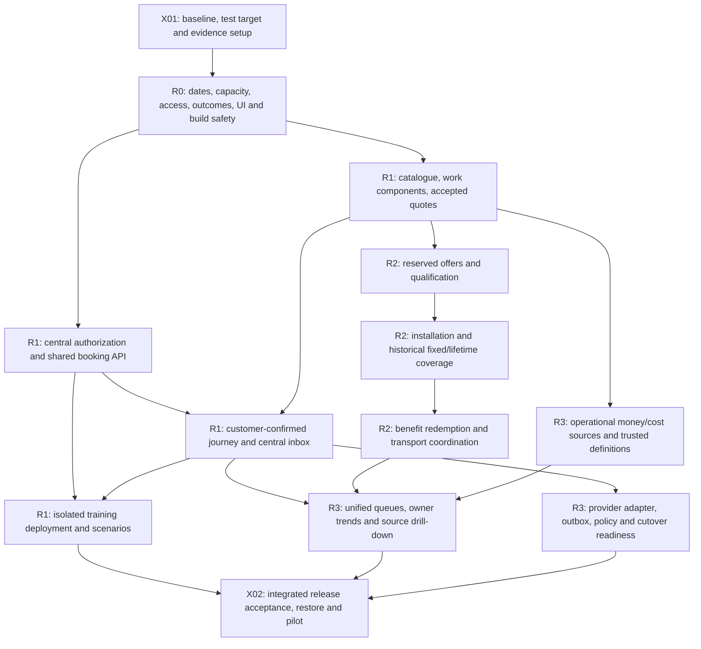

# Phase 1 Full Operational Product Implementation Plan

> **For agentic workers:** REQUIRED SUB-SKILL: Use superpowers:subagent-driven-development to implement this plan task-by-task after the user reviews it and authorizes implementation. Steps use checkbox (`- [ ]`) syntax for tracking. This planning session does not authorize implementation, database writes, provider activation, deployment, commits or pushes.

**Goal:** Deliver every Phase 1 finding and approved addition as a coherent operational Garage OS product, with an isolated auxiliary training experience and independently verifiable releases.

**Architecture:** Retain React/Vite, Express, PostgreSQL, Clerk and `@garage/domain`. Reuse one transaction-safe booking service, one versioned commercial contract chain, one warranty issuance service, one central inbox, and shared authorized reporting/queue projections. Train against a separate fictional database and deployment using the same domain code, never against operational data.

**Tech Stack:** Existing TypeScript npm workspace, React 19, Vite, Express 5, pg, Zod, Vitest; scoped Playwright development harness proposed for browser/print acceptance.

**Spec:** [Accepted requirements](../../product/PRODUCT_DIRECTION_AND_RELEASES.md), [entire Phase 1 tracker](../../testing/PHASE_1_ISSUES_TRACKER.md), [planning handover](../../operations/PHASE_1_FULL_PLAN_HANDOVER.md). This document and the three linked workstreams form **one planning package**. Workstream implementation decisions are proposals for review; accepted product scope and security constraints are already binding.

**Prepared:** 16 November 2026. **Inspected HEAD:** `8d61080f64cea8231d2d403dc6dd3a394aa592ce` plus the existing dirty working tree. **Implementation state:** not started by this task; all 44 tracker issues remain Open/Unassigned. Assigned roles below are proposed execution accountability, not tracker status changes.

## Global Constraints

- Garage OS is the **full functional operational product**. Demonstration/training is an isolated auxiliary layer over the same real business behavior.
- Six WhatsApp business numbers feed **one central handling team**. Receiving number determines reply channel; chosen branch determines availability.
- Normal supported automation checks availability, collects required details, gets customer confirmation and atomically creates a confirmed booking. Routine staff approval is **not** the primary successful path.
- Real Owner settings remain real settings. No fake approval polls, front-end role privilege switching or silent policy activation. Staff identity and permissions must be enforced server-side.
- Maintain Arabic/RTL and English/LTR; preserve current stack/domain boundaries and Replit entry/port controls unless a concrete alternative is separately justified.
- Preserve `.replit`, local port `5000`, `apps/server/index.ts`, root dev/start/migration/seed commands and facades, and `scripts/post-merge.sh` hook path. Correct the hook's validation order without replacing the Replit control points.
- Database integration suites require an explicitly identified **dedicated disposable** `GARAGE_TEST_DATABASE_URL`. Never use ambient `DATABASE_URL`, shared Replit or production for destructive test fixtures.
- Existing user changes and research artifacts are inputs. No staging, commit, push, reset, seed, migration or production/private-data collection is part of this planning task.
- Business-policy approval is separate from feature approval. Missing prices, lifetime definitions, benefit limits or finance inputs stay explicitly unconfigured/unavailable; advertised examples cannot become active promises.
- Existing fixed-term coverage and accepted customer agreements keep their historical meaning. Corrections append evidence and references; they do not silently rewrite history.
- Provider delivery remains disabled until actual configuration, account eligibility, approved policy, security and end-to-end evidence satisfy the readiness gate. Simulated receipt states never establish live delivery.

## Review Focus

1. A committed mutation whose refresh fails must not invite a duplicate write; revoked access must still clear protected data (O02).
2. Two different entry points compete for the last capacity or entitlement: at most one valid commitment, same lock/date semantics and no partial downstream state (O01, commercial reservation/redemption tasks, M03).
3. A package or policy changes after acceptance but before installation: the recorded accepted version, entitlement and approved terms remain authoritative (commercial quotation, reservation and coverage tasks).
4. A central-team grant or scenario control accidentally widens finance/warranty/workshop access: authorization is checked on each protected service and direct API action (M02/M04 and cross-domain tests).
5. A provider times out after possible acceptance or emits delayed receipts: no blind resend, false delivered state or regression to an earlier receipt state (M06–M08).

## Read and execute this package

| Document | Responsibility | Lead assignment |
|---|---|---|
| This master plan | Scope, ordering, release and approval gates, integrated coverage, continuation | Controller / release integrator |
| [Operations workstream](2026-11-16-phase-1-operations-workstream.md) | O01–O14: date/capacity, outcomes, auth, original UI defects, build, report UI, queues, guided forms, configured slots and atomic changes | Operations engineer; auth specialist on O04; frontend/accessibility engineer on UI slices |
| [Messaging workstream](2026-11-16-phase-1-messaging-workstream.md) | M01–M08: central permissions, conversation engine, scenarios, triage, provider reliability | Messaging/backend engineer; security reviewer on M02/M04/provider work |
| [Commercial workstream](2026-11-16-phase-1-commercial-workstream.md) | C tasks: catalogue/quotes, reservations, coverage, benefits, qualification, transport, financial sources; all 33 facts | Domain/data architect; warranty and finance specialists for their bounded tasks |

Each workstream provides inspected files, proposed files/interfaces, checkbox tasks, regression assertions, commands, migration/recovery and its issue rows. This master resolves shared ownership: **O01 owns booking/capacity**, **O03 owns selection-state fixes**, **O04 owns demo-role diagnosis**, **M04 owns whole scenario isolation**, **commercial owns warranty lifecycle and financial calculation**, **O11 owns report presentation**, **O12 owns queue aggregation**, **O13 owns reusable guided interaction**. M01 coordinates O03/O04 acceptance; it is not a second implementation. Do not run two implementers against overlapping files.

For future execution, use a fresh implementer per bounded task, then a fresh reviewer for specification compliance and task quality before the next task. Architecture, database/concurrency, security and final integrated review need the most capable available model; routine deterministic UI work can use the workhorse model. In this planning session, operations and messaging specialists used `gpt-6.1-terra` with high reasoning; the commercial/domain specialist used `gpt-6-astra` with high reasoning. These are contributor assignments, not business authority. Recheck model availability when executing.

## Evidence and current state

Fresh evidence here is **source inspection**, not reproduction. No application, browser, database, unit or build suite was run to establish a new baseline during planning. Historical reports describe their own snapshots only; the previously recorded 44 passing tests, skipped DB suites and 654.68 kB bundle do not establish today's status.

| Inspected boundary | Reuse | Gap and owning task |
|---|---|---|
| `apps/server/infrastructure/database/db.ts`; operations `api.ts`/`bootstrap.ts`; domain `rules.ts` | pg transactions, advisory locks, confirmed-booking capacity rules | SQL DATE mapping differs between `String(...).slice` and ISO conversion; no single booking writer. O01 fixes boundary and direct/automated confirmation. |
| `apps/web/src/shared/store.tsx`; `app/App.tsx` | Persisted mutation APIs and bootstrap | Refresh errors can replace a loaded workspace and obscure a successful write. O02 separates write/read outcomes and revocation. |
| `auth/demo-auth.ts`, `auth.ts`, `authz.ts` | Signed short-lived demo cookie; individual Clerk identity; role/branch checks | Receptionist/technician failure causes still need separate reproduction; central messaging capability absent. O04/M02. |
| Operations bootstrap and booking UI | Effective server settings and service durations | Receptionists can receive illustrative duration definitions rather than effective read data. O05. |
| Warranty routes, rules, evidence, invoices and migrations `0003`–`0009` | Immutable published versions, claims, private evidence, hashed QR tokens, invoice drafts | Fixed 1–120 month term; required expiry; duplicated issuance in delivery and manual endpoint; no package component model. Commercial coverage tasks consolidate without rewriting existing meaning. |
| `whatsapp/whatsapp.ts`, `whatsapp-policy.ts`, simulation page and `0005_whatsapp_simulation.sql` | Persisted fictional transcripts, guarded simulation, exclusive assignment, verification helpers | Branch-based simulator references ordinary operational rows; no six-channel central model, live adapter, outbox or full isolation. O03/M02–M08. |
| Domain `Service`, `Booking`, `Vehicle` | Shared types and pure rules | Text price label/single service cannot represent accepted package versions, reserved promotions, redemption or transport. Commercial tasks add explicit contracts. |
| `OverviewPage.tsx`, existing bootstrap | Operational counters | No reliable cost/revenue/profit sources; report filters and source reconciliation absent. Commercial finance task + O11/O12. |
| `scripts/post-merge.sh`, `package.json`, `tsconfig.json`, migration runner | Stable Replit hook/facades; transactional per-file migration tracking | Migration precedes build and target is ambient; build omits server typecheck; pages eagerly imported. O10. |
| Existing `*.test.ts` and `vite.config.ts` | Pure/auth/warranty tests; DB integrations explicitly skip without test URL | No established browser acceptance harness. Task X01/O04 establish it before dependent browser tests; skipped DB suites cannot count as acceptance. |

The instructions, PRD, architecture/data model, WhatsApp/evidence/security specifications, delivery outline, fact register, meeting dossier, workflow research and scenario proposal were read as requirements/evidence. See their links in the workstreams. Historical branch-team routing, routine approval and demo-first suggestions are superseded by the latest dated accepted requirements; research collection is already done.

## Design decisions proposed by this plan

These are normal engineering choices, not newly approved business policy:

1. **Separate deployment/database for training.** Same app/domain build, distinct server configuration, database credentials, cookie/signing secrets, storage bucket and environment marker. Operational runtime never selects a database from a request/header/UI control. Demo authentication and scenario/reset endpoints require the training marker and remain unavailable in production. Training has no provider credentials and no route to a live adapter. M04 makes this executable.
2. **Canonical DATE at the database boundary.** Select SQL DATE as validated date-only text consistently; preserve timestamp/instant semantics. Never attempt timezone correction of persisted dates absent evidence the stored date itself is wrong. O01 owns mapping and lock keys across all callers.
3. **One booking transaction API.** `reserveConfirmedBooking(client, actor, input)` owns authorization, idempotency, capacity locks and booking/job write on the supplied client. Callers own transaction commit and compose entitlement consumption/outbox intents on that same transaction; customer confirmation must be server-verified. Retain existing staff pending-policy behavior where applicable, but normal supported WhatsApp success is explicitly confirmed, not manager-pending. No UI setting is silently changed to achieve it.
4. **Versioned contract chain.** Catalogue/offer version → quote revision + acceptance evidence → optional commercial entitlement → scheduled booking/work components → delivered work → component coverage and benefits. One customer visit does not become duplicate jobs merely to represent bundle components. No arbitrary lifetime expiry, no collection inferred from a deposit reference.
5. **Read projections, not new workflow engines.** Finance, queue and owner exception views consume persisted source facts and share filters/definitions. They cannot invent completion, due dates, cost completeness or SLA policy. Immutable history remains in owning modules.
6. **Durable PostgreSQL event/outbox state.** Reuse PostgreSQL for unique inbound events and outbound intents/leases; adapter is transport-neutral. Ambiguous provider acceptance is held for reconciliation rather than retried blindly. Future readiness validates current primary Meta documentation; this planning task makes no new external policy assertion.

## Release graph and delivery sequence



| Release | Independently useful outcome | Gate and remaining scope |
|---|---|---|
| R0 — trustworthy foundation | Existing operational booking/auth/UI works reliably, with guarded validation before DB mutation | O01–O10; no claim that new commercial or messaging scope is complete. Each original low-severity issue retains acceptance evidence. |
| R1 — operational enquiry to accepted booking | Structured catalogue/quotes, central six-channel disconnected inbox, real automatic-booking domain flow, separate training walkthrough | O13 booking; commercial catalogue/quote foundations; M02–M05; isolated DB and UI/API tests. Provider is visibly disconnected, not a successful live release. |
| R2 — preserved promises and fulfillment | Reserved offer later schedules against capacity; approved historical fixed/lifetime coverage; benefits, qualification and transport are auditable | Commercial fulfillment tasks + O13 warranty integration; approved terms required for actual issuance/redemption. Unconfigured policy does not block unrelated engineering. |
| R3 — owner visibility and verified pilot | Trusted operational monetary sources/definitions, shared exception queues and trends; verified provider adapter and recovery | O11/O12; commercial finance; M06–M08; X02. Missing finance inputs stay unavailable; missing provider evidence blocks live messaging readiness. |
| Later explicit versions | Existing PRD inventory/movements/reorder work, broader notifications and nonessential layout customization | Keep visible in delivery backlog; not a closure substitute for P1-001–044. Full accounting/POS, fleet/GPS and configurable workflow builder are outside the accepted operational coordination slices. |

Release numbers are ordering labels, not dates or authority to defer an issue. A release can be accepted for its own stated scope while the wider tracker remains open. Moving accepted scope to a later version needs a recorded reason and Owner approval; this plan schedules every accepted Phase 1 addition across R0–R3 rather than silently deferring it.

## Cross-workstream execution rules

- Execute X01 first, then O01/O02/O04/O05/O10 foundation gates before dependent automation; O14 supplies configured time-slot availability and atomic booking changes before the automated journey. O03/O06–O09 can be separate bounded sessions once their test prerequisites exist. O10's browser performance portion follows the browser harness.
- Fix O01's existing date/capacity boundary first; O14 adds actual configured time-slot/occupancy availability and atomic reschedule/cancel. C04 extends work demand after commercial contracts exist. A generated list of business-hour labels is not proof of availability. O14 requires approved opening/closing, timezone, closures and slot/occupancy rules; missing configuration returns unavailable. Exercise mixed staff/automation/reservation writers in one DB integration, not only isolated unit tests.
- Commercial catalogue and quote tasks precede promotion reservation. Approved acceptance/sale snapshots precede downstream coverage/benefits; qualification state and reservation allocation must compose atomically rather than redeeming twice.
- M02 permissions precede operational cross-branch context. M03 uses O01/O14 and commercial immutable context; M05 owns inbox triage. M04 isolates the same services and scenario entry; it does not create a parallel business implementation.
- O13 owns the shared interaction reducer; commercial warranty and messaging journey consume it. O11 consumes finance results and O12 consumes source contributors. Keep operational/customer stage labels in shared UI, not a second translation map per page.
- Migration filenames are allocated serially by the controller after inspecting the then-current directory. Existing two `0005` files are tracked by full filename and must not be renamed. Each task names its proposed new migration; allocate unique monotonically ordered final filenames before dispatch and update consumer references together.
- Keep exact producer/consumer interfaces in both task briefs. If a revision is needed, change the planning contract and dependent tests before dispatching consumers; never let implementers independently invent variants.

## X01 — Baseline, safe test harness and evidence checkpoint

**Owner:** Controller with operations/test engineer. **Release:** R0 prerequisite. **Files:** read `AGENT_INSTRUCTIONS.md`, scoped guides, tracker, package/configs and existing tests; create only when implementation is authorized `tests/e2e/` fixtures and `playwright.config.ts` as specified by O04; modify `package.json`/lockfile only for the scoped browser dev dependency. Evidence file: `docs/testing/phase-1/R0-baseline.md` (proposed).

**Interface:** every execution task receives `{taskId, baseRevision, dirtyFilesToPreserve, requirements, producerContracts, dedicatedTestTarget, evidencePath}`. Database identity evidence is sanitized and never includes credentials. No default to ambient `DATABASE_URL`.

- [ ] Inventory working-tree changes and identify task-owned edits; preserve all unrelated content. Detect current isolation/worktree constraints before choosing any checkout. User authorization for implementation still does not authorize Git commit/push or production changes.
- [ ] Run `npm run typecheck`, `npm test -- --run`, `npm run build` in the approved development workspace; record exit codes, exact counts, skips and warnings. If dependencies are absent, record installation need and use ordinary approval/sandbox controls. A skipped DB suite is **not tested**.
- [ ] Identify a dedicated disposable test database and explicit test-environment marker before DB integration. Confirm database name/host class out of band without printing URL; reject production/shared targets. Apply migrations to that target only after explicitly verifying the migration command's `DATABASE_URL` is the same approved disposable target; seed fictional fixtures scoped by tests.
- [ ] Establish O04's minimal browser harness with four role identities, two fictional branches, locale/viewport fixtures and safe network failure injection. Confirm Vitest includes any selected `.test.tsx` tests; otherwise use pure `.test.ts` reducers and browser tests. No phantom commands or uninstalled tools count as test evidence.
- [ ] Run one browser smoke check against the fictional app and existing guarded DB suites separately: `npx vitest run apps/server/features/whatsapp/whatsapp.integration.test.ts apps/server/features/warranty/warranty-ledger.integration.test.ts`. Observable result is actual non-skipped passing tests; a missing target is a named blocker for DB gates, not permission to use another database.

## Integrated issue matrix

**Coverage: 44 of 44 current IDs, P1-001–P1-044; next unused P1-045.** Each row names the accountable execution role, not a staff access grant. Task references identify exact existing/proposed paths and detailed commands in the workstreams. Source paths below are relative to `apps/` unless prefixed `packages/`, `scripts/` or configuration. B keys refer to the business register below; “none” means no new business policy is needed, while ordinary design/browser review still applies.

| Issue | Acceptance owner; tasks/release | Dependencies | Primary source surface | Independent closure evidence | Remaining business gate |
|---|---|---|---|---|---|
| P1-001 | Operations; O01 / R0 | X01 | `server/features/operations/api.ts`, `booking-service.ts`; domain rules | Full daily and bay limit, correct pending confirmation/pickup, last-slot race, one job and replay | B01 capacity values |
| P1-002 | Operations; O01 / R0 | X01; shares boundary with 001 | DB date-only boundary, bootstrap, WhatsApp and warranty date readers | Same exact DATE under UTC/Cairo, leap/year/offset boundaries, unchanged fixed expiry | None |
| P1-003 | Frontend; O06 / R0 | X01 browser harness | `web/src/features/warranty/WarrantyInvoicePanel.tsx`, warranty CSS | Two expanded invoices print separately; cancellation, multipage, Arabic/English and QR | None |
| P1-004 | Frontend/data; O02 / R0 | X01 | `web/src/shared/store.tsx`, `app/App.tsx` | Successful POST + failed GET shows saved/stale; GET-only retry, failed POST and revoked access separate | None |
| P1-005 | Auth/frontend; O04 / R0 | X01 | App shell, auth logout and demo cookie | 375/768/desktop sign-out in both auth modes; protected request after logout denied | None |
| P1-006 | Operations; O05 / R0 | O01 effective rules | `server/features/operations/bootstrap.ts`, booking selector | Reception sees Owner-saved hours used by capacity; private/other-branch reads and PATCH denied | B01 service hours |
| P1-007 | Frontend/messaging; O03, M01 / R0 | O02; final isolation M04 | Simulation page and draft endpoints | A→B/branch/session switch with late responses; no cross-content/send; mismatched server draft rejected | Explicit isolated draft lifetime |
| P1-008 | Auth; O04, M01 / R0 | X01 | `server/features/auth/demo-auth.ts`, API/bootstrap, DemoAccountPanel | Receptionist separately diagnosed; session/refresh/permitted work; disabled/conflict/production/branch denials | Fictional fixtures only |
| P1-009 | Auth; O04, M01 / R0 | X01 | Same auth chain plus technician bootstrap | Technician separately diagnosed; empty and assigned-work success; phones/other work/inbox denied | Fictional fixtures only |
| P1-010 | Warranty/frontend; O07 / R0 | O04 | `WarrantiesPage.tsx`, warranty routes/rules | True drafts cannot issue through UI/API; published name/status/version unambiguous | B05 before actual publication |
| P1-011 | Auth/frontend; O04 / R0 | X01 | AuthApp/App locale initialization and shared store | Clean and saved locale through access/loading/error/refresh, RTL/LTR and safe recovery | None |
| P1-012 | Frontend; O08 / R0 | O04 usable technician session | `web/src/shared/ui.tsx`, WorkshopPage | Distinct receipt/delivery Arabic without diacritics; filters and stored stage keys unchanged | Native Arabic copy review |
| P1-013 | Frontend/operations; O08 / R0 | O04 | Workshop assignment UI/API | Each selection/eligibility/unchanged/pending guard explained accessibly; valid assignment and denial tests | None |
| P1-014 | Frontend; O08 / R0 | X01 browser harness | BookingsPage vehicle select, shared CSS | Long labels open/closed, keyboard/mobile native picker, zoom and four widths; measured clipping resolved | Supported browser/OS set |
| P1-015 | Frontend; O09 / R0 | X01 browser harness | AuthApp landing header and shared CSS | Brand/divider/action alignment without clipping/overflow at four widths and 200% zoom | Design review only |
| P1-016 | Frontend; O09 / R0 | X01 browser harness | Shared `.landing-preview` | Unrotated informational card remains readable across breakpoints/zoom | Proposed presentation reviewed |
| P1-017 | Frontend; O09 / R0 | X01 browser harness | Shared page/scroll-container CSS | Mouse/touch/keyboard scroll, visible native fallback, OS themes and forced colors | Supported browser set |
| P1-018 | Frontend; O08 / R0 | O01 | Booking table and shared date/time helpers | Consistent locale digits/bidi/alignment, unchanged canonical DATE/HH:mm | Locale numbering convention |
| P1-019 | Frontend; O08 / R0 | X01 browser harness | Booking labels/shared form CSS | Required marker and label wrap together, accessible required semantics in both directions | None |
| P1-020 | Frontend; O08 / R0 | O01/O08 display | Booking native time input | Midnight/noon/leading zero, mobile and keyboard; valid HH:mm submission in both locales | Supported hour-cycle convention |
| P1-021 | Frontend; O07 / R0 | X01 browser harness | Warranty tabs/CSS | Measured vertical arrow cause resolved; horizontal reach/focus/selected tab at zoom and RTL | None |
| P1-022 | Warranty/frontend; O07 / R0 | O04; linked 010 | Warranty issuance guards/UI/routes | Every prerequisite has guidance; valid issue exactly once; duplicates/drafts/out-of-branch rejected | B05 terms and existing role rules |
| P1-023 | Release/data; O10 / R0 | X01 | `scripts/post-merge.sh`, DB migration runner | Failed validation or wrong target yields no migration; disposable success/failure and recovery | Explicit intended DB identity/operator |
| P1-024 | Release; O10 / R0 | X01 | `package.json`, `tsconfig*.json` | Deliberate server type error in isolated fixture fails required gate; clean web/server/build succeeds | None |
| P1-025 | Frontend/performance; O10 / R0 | Browser harness; O02 recovery | App eager imports, Vite config | Comparable initial transfer/parse/build measures; direct route, failed chunk, auth, QR/print recovery | Representative device/network budget |
| P1-026 | Messaging; M03/M04/M05, O14/O13, C02–C04 / R1 | O01/O02/O04/O05, M02; C01–C03 | Journey, shared booking/slots, scenario/entry, quote context | Operational customer confirmation persists confirmed booking with no staff claim; bilingual two-pane and narrow journey; conflict/handoff/status/change recovery | B01/B03/B10 configured answers; provider gate separate |
| P1-027 | Messaging/security; M02/M04/M05 / R1; M06–M08 / R3 | O01/O14; central access; isolation | Inbox/access/channel/provider modules | All six channels central view, source-number reply, branch change preserves agent; nonmembers denied; scenario/live separated; real provider evidence for live claim | B02/B10/B11; disconnected release does not close live readiness |
| P1-028 | Warranty/frontend; C08 / R2 | O02/O06/O07/O13; C06/C07 | Warranty summary/detail/editor components | Default summaries, contextual draft edit/claim/evidence/invoice/verify, retained input, permitted actions and history | B05; non-destructive entity lifecycle |
| P1-029 | Owner-report lead; O11/O12, C12/C13 / R3 | Source modules, finance definitions | Overview, shared filters/projections, finance service | Monthly financial/trend/table and exception drill-down reconcile, filters survive navigation, unavailable explicit | B09/B10 and source due rules |
| P1-030 | Product/controller; C01/C13 plus canonical 032–037 / R1–R3 | Saved workflow research; accepted scope | Existing research + each canonical adaptation | Six patterns traced to reviewed/verified acceptance; no repeated research or duplicate feature implementation | Only recorded policy parameters; shortlist already accepted |
| P1-031 | Product/domain lead; C01 / R1 with policy follow-through R2/R3 | Saved facts/dossier | Approved policy/evidence records and 33-fact mapping | Research limits preserved; current roster/authority/price/terms evidence explicitly confirmed or unresolved; no social role grants | B01–B11 applicable owner evidence; not closed by plan alone |
| P1-032 | Messaging; M02/M05 / R1 | M03/M04; C03 context | Central inbox/assignment/handoff | Competing claims one owner; private notes; waiting/human-response due; bot pauses, reopen, ownership survives branch switch | B10 due/calendar; no assumed SLA |
| P1-033 | Reporting/frontend; O11/O12, C12/C13 / R3 | P1-034 sources and source queues | Overview/shared report filters/source drill-down | Same branch/period/grouping/currency, accessible chart/table, previous period/zero base, reconciled source details | B09 reporting definitions |
| P1-034 | Finance/data; C12; O11 presentation / R3 | C03/C05/C09–C11 source contracts | Finance events/adapters/service and domain finance | Draft/unpaid/partial/refund/missing cost/finalized/multi-currency fixtures; source counted once; summary/detail access | B09; no invented profit |
| P1-035 | Warranty/domain; C07/C08 / R2 | C06, O07/O13 | Policy lifecycle and contextual warranty forms | Draft create/edit/duplicate/retire; original issued version retained; fixed/lifetime fields and hidden validation correct | B05, permitted draft-field choices |
| P1-036 | Operations; O12, C13 contributors / R3 | M05 inbox; C05/C07/C09/C11 records | Shared work-queue coordinator and source projections | Role-scoped actionable counts match records, optional columns, transition removes item, no invented waiting/due state | Approved responsibility/commitment definitions |
| P1-037 | Frontend interaction lead; O13 / R1 booking, R2 warranty | O01/O02/O14, C08, M03 | Shared task steps plus booking/warranty/journey | Back retains valid input, prerequisite change clears only dependents, hidden omission rejected server-side; focus/retry/discard/identity isolation | Draft retention boundary; fixed rules, no workflow builder |
| P1-038 | Architecture/controller; M04 + all releases + X02 / R0–R3 | O04; shared domain services | Deployment/DB markers, auth/scenarios/reports/outbox | Training/live read-write/reset/identity/provider/report boundaries, same business/RBAC rules, phases truthfully labeled | B11 environment/operations ownership |
| P1-039 | Commercial/domain; C01–C04 / R1 | O01/O14, M02 context | Catalogue/packages/quotes/work components | Vehicle/roof/add-on scope, missing price not zero, immutable accepted revision, unauthorized override/retry, one intake/job and component capacity | B03 prices/tax/vehicle/occupancy/acceptance |
| P1-040 | Commercial/data; C05 / R2 | C03/C04; C10 qualified paths; O14 | Reservation and allocation/booking services | Reservation consumes no capacity; later schedule atomic; old accepted offer preserved; retry/cancel/refund history | B04; deposits distinct from collections |
| P1-041 | Warranty/data; C06/C07 / R2 | O01; C03/C04 sold bindings | Term model, issuance, claims/QR/print/migration | Legacy fixed exact dates/terms, leap/month end, lifetime null expiry/definition, claim/privacy/print consistency | B05 approved lifetime contract |
| P1-042 | Commercial/aftercare; C09 / R2 | C03/C07 accepted trigger; C13/O12 | Benefits/eligibility/redemption | Finite/recurring/unconfigured cases, concurrent last entitlement, reversal audit, retained old promise, authorized queues | B06 limits/transfer/branches/fulfillment |
| P1-043 | Commercial/transport; C11 / R2 | C04/C09; C13/O12 | Transport requests/resources/contact projection | Pickup/return/courtesy distinct, unavailable/conflicting resource not committed, custody/exception/privacy, no job auto-delivery | B07 responsibility/area/fees/custody |
| P1-044 | Commercial/promotions; C10 / R2 | C01/C03; C05/C09 consumers | Qualification/evidence/allocation | Verified/invalid/expired/used evidence, one last allocation under concurrency, exact grouped discounts/reversal and private evidence | B08 stackability/limits/beneficiary/authority |

## Business confirmation register and feature gates

Business questions ask the appropriate approver for existing evidence, not the user to invent terms. Build types, validations, unavailable states and fictional tests while answers are outstanding. A policy-dependent activation waits for its row; unrelated work continues. Keep dated approved revisions and evidence references with the configuration/contract, not just in chat.

| Key | Parameter/evidence required | Appropriate approver | Affected activation; safe unconfigured behavior |
|---|---|---|---|
| B01 | Current active branches, bookable services, hours/timezone/closures, bay/drop-off and appointment/occupancy rules; authoritative operating sheet | Owner + operational branch lead | Slot offering/capacity activation; unavailable schedule and human help, no inferred Sunday or same-day rule |
| B02 | Six exact business assets/number IDs and central member grants; provider ownership/migration/coexistence evidence | Owner + authorized Meta administrator | Live channels and central membership; disconnected channels, nobody enrolled from profile role alone |
| B03 | Current grade/package/roof/add-on/vehicle classification, price/currency/tax precision, quote validity and override/acceptance authority; approved price matrix | Owner/pricing authority + accounting for tax | Quote publication and acceptance; explicit quote required/unconfigured, never free or zero by omission |
| B04 | Reservation price-lock, limited allocation, deposits/source, expiry/refund/cancellation/change/branch-redemption terms; approved offer contract | Owner + finance/operations approvers | Promotion reservation/redemption; keep reference distinct from payment, no inferred two-year entitlement |
| B05 | Lifetime subject/termination/remedy/issuer/exclusions/maintenance/transfer and public wording; approved blank warranty and terms versions | Owner + appropriate legal reviewer | Coverage publication/issuance; typed unconfigured lifetime cannot issue; legacy fixed coverage remains valid |
| B06 | Benefit frequency/quantity/duration, eligible vehicle/person/branches, fulfillment/correction and transfer rules | Owner + aftercare lead | Benefit grant/redemption; no unlimited free service or inherited expiry from edited promotion |
| B07 | Pickup/return area/fees, provider custody/responsibility, resource availability, contact/location retention and VIP scope | Owner + transport operations lead | Confirmed transport commitment; request is unconfirmed when resource/policy unknown, no driver contact |
| B08 | Referral/card/group/multi-car eligibility proof, stackability, limits, beneficiary/allocation, correction and exception authority | Owner/promotion approver | Qualification/redemption; pending verification, minimal private evidence, no warranty transfer implied |
| B09 | Currency/date basis, recognition, deposits/refunds/taxes, cost completeness, gross versus net, overhead, financial role access and rounding; signed metric dictionary and redacted examples | Owner + qualified accounting approver | Financial metrics; quoted/draft, collected, balances, cost and profit separate, missing inputs unavailable |
| B10 | Response-due/waiting rules, working-hours/SLA thresholds, notification recipient, template/language/consent/retention/window rules | Owner + central team lead + privacy/provider administrator | Timers/alerts/live messages; elapsed time may display, no assumed SLA or alert activation |
| B11 | Public warranty allowlist, retention/export/scan/backup ownership, incident contacts and pilot approval evidence | Owner + privacy/security/operational responsible person | Public QR, real evidence storage, production pilot; existing Owner gate remains off until approved |

The commercial workstream's **GS-F001–GS-F033 mapping** is a required part of this package. Information-only facts (audience, history, self-reported positions) are retained as context, not staff grants or new features. The six cross-industry adaptations are preserved under canonical P1-032–037 rather than repeated discovery work.

## Migration, backfill and rollback contract

Every schema-owning task must produce a migration rehearsal report with existing-row counts and invariants, an empty database run, a populated legacy run, interrupted/repeated application, and compatible old/new app behavior. Existing migrations are immutable. Expand schema first; deploy readers that understand both shapes; backfill only values derivable from stored evidence; validate constraints; contract legacy paths only after the compatibility window and approval.

- Existing bookings retain dates/status/source and legacy jobs remain one per booking. Unknown old catalogue/quote data is marked legacy/unknown; do not manufacture customer acceptance or approved price history.
- Existing warranty versions map to fixed terms using their exact months/start/expiry; issued dates, claims, QR hashes, print history and private evidence links must remain unchanged. Component-aware uniqueness preserves legacy null-component uniqueness. Never infer lifetime from a product name.
- Old invoice draft payment amounts stay historical draft data; conversion to auditable money events requires verified source and explicit correction/import evidence. Never count both old totals and imported events.
- Simulation records require inventory of their full linked graph before classification. Ambiguous rows are quarantined for review, not relabeled live, automatically deleted or copied into training as customer data. Training starts with fictional fixtures; reset creates a new scenario and cannot erase operational/audit history.
- Rollback before business use can restore the previous compatible app over additive schema. After new business writes, disable affected activation/worker, hold pending effects, reconcile state and apply a forward fix. Never drop accepted quotes, issued coverage, redeemed benefits or provider evidence to make rollback convenient.
- Backups include database and private storage manifest/objects; rehearsal restore verifies record counts, relationships, evidence access, QR privacy and pending outbox state. Prevent restored outbox from resending previously accepted messages without reconciliation. Existing migration runner is development-only; any production migration path requires a separately reviewed targeted release procedure, not setting `NODE_ENV=development` against production.

## X02 — Integrated verification, operational recovery and release acceptance

**Owner:** Release integrator; independent security/data and workflow reviewers. **Release:** each release checkpoint, with final R3 pilot gate. **Files:** proposed `docs/testing/phase-1/R0-acceptance.md` through `R3-acceptance.md`, `docs/operations/PHASE_1_RELEASE_RUNBOOK.md`, provider runbook from messaging tasks; update tracker/decisions/project log only after actual implementation/evidence.

**Interface:** release evidence record `{release, revision, taskResults, issueEvidence, environmentClass, databaseTestIdentity, skippedChecks, businessApprovals, migrationRestoreResult, providerChannelResults, reviewerVerdicts, outstandingScope}`. No secrets or real transcripts.

- [ ] Execute the task-specific regression commands in the workstreams. Follow each by `npm run typecheck`, `npm test -- --run`, `npm run build` after source changes. Record actual pass/skip/fail, not expected text. New failure triggers diagnosis; do not mask it with warning thresholds or fictional success.
- [ ] Exercise one complete fictional sale: channel A → requested branch B → eligible vehicle/package → accepted quote → customer-confirmed atomic slot → job/intake/assignment/service/QC/delivery → historical fixed/lifetime coverage as configured → benefit redemption and transport → authorized owner exception/finance source drill-down. Also test simple standalone booking without promotion, deferred offer without a slot, retired catalogue terms, failed persistence, duplicate event and lost last slot.
- [ ] Verify all four roles, explicit central capability versus nonmember, direct URLs/API IDs, branch isolation and assigned-technician privacy. Test revocation while viewing data, logout/session expiry and no draft transfer across identity/scenario/conversation.
- [ ] Verify Arabic/RTL and English/LTR at 375/768/1024/1440px, 200% zoom, keyboard/focus/error association, native date/time/select controls on supported browser/OS, chart/table alternatives, invoice/QR print preview and cancellation. Record browser/version/OS/build, fixture, role/branch/locale and sanitized screenshots/PDF.
- [ ] Run DB concurrency tests using separate connections for direct staff booking versus customer confirmation versus reservation redemption, concurrent claims, limited offer/benefit redemption, delivery/manual warranty issuance and repeat migrations. Expected capacity, unique acceptance/redemption/coverage and audit invariants hold after retries/rollback.
- [ ] Rehearse backup/restore and outage recovery on disposable staging targets. Test DB/worker/storage/provider failure, held/retried/outcome-unknown outbox, manual fallback, export and private evidence access. Assign incident/support owners and retention/monitoring thresholds before live pilot; no real evidence before scanning/readiness configuration.
- [ ] For live messaging readiness, messaging runbook must record inbound/outbound/receipts and invalid signature/replay/outage tests for all six authorized channels, exact number-to-channel identity, approved templates/windows/consent and per-channel cutover/rollback. Use approved test recipients in a later authorized integration session. Unconfigured provider or fake adapter results cannot pass this live gate.
- [ ] Conduct independent whole-product review after scoped tasks; review data migration/historical meaning, permission boundaries, actual user journeys and this plan's Review Focus. Resolve material findings, then record each issue's implementation and **separate** dated retest evidence. Only mark Verified after its own acceptance passes; planning, build success, umbrella completion or shared-task completion alone does not close it.

## Session handoff and checkpoint

Run one bounded checkbox task/subslice per implementation session where practical. Large transaction/schema tasks may need a domain/migration subtask followed by an API/UI slice, each with its own regression and reviewer gate; keep parent acceptance open until both pass. No calendar estimates are promised. At session end write the following in a task-owned checkpoint under `docs/superpowers/plans/checkpoints/` (proposed during execution):

```text
Plan/release/task and accountable owner:
Base revision and preserved pre-existing changes:
Completed checkbox steps and exact files changed:
Producer contracts consumed/produced (including version):
Migration names, applied target class, backfill counts, rollback limit:
Commands actually run, exits/counts/skips and evidence paths:
Spec compliance / quality review verdicts and unresolved findings:
Issue IDs: implementation state vs independent retest state:
Business gates still unconfigured and evidence/approver needed:
Next executable checkbox, prerequisites, and explicit stop conditions:
Provider/dataset effect state (disconnected/simulated/live evidence):
```

Resume by reading master + owning workstream + checkpoint + producer contracts; inspect `git status`, do not restart completed research/tasks. Dispatch the next permitted task only after dependencies/reviews pass. Preserve user-selected **subagent-driven execution**; do not start it until plan review and implementation authorization. No new feature-shortlist discussion is required.

## Planning validation record

Documentation checks: current tracker confirms 44 issue IDs; the master matrix contains 44 distinct rows, the operations matrix 29 rows, messaging 7 rows and commercial 12 rows (44 total without duplicate canonical ownership). Commercial contains 33 GS-F rows. Relative links in the four plan documents resolve. Shared contracts were reconciled across O01/O14, C04/C05/C12/C13 and M03/M04/M06–M08. An independent review attempt could not complete because the review agent hit its usage limit; no review findings were received. No application tests, browser checks, builds, database migrations or runtime retests were run; the integration check for this task covered documentation only.


