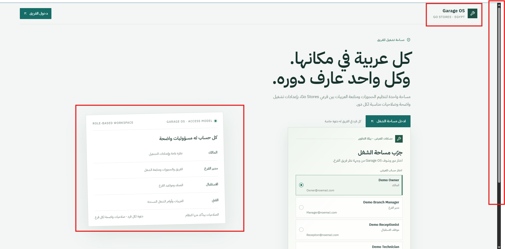
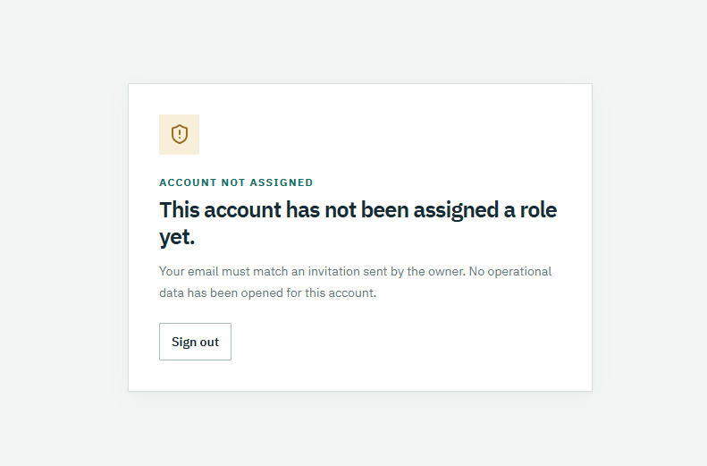
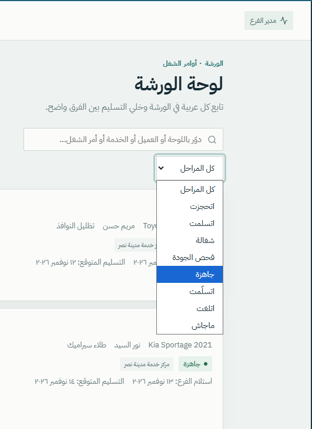
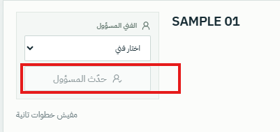
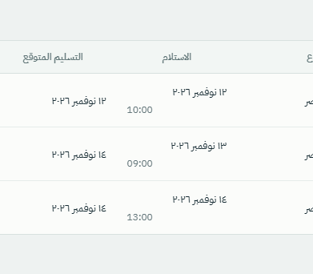
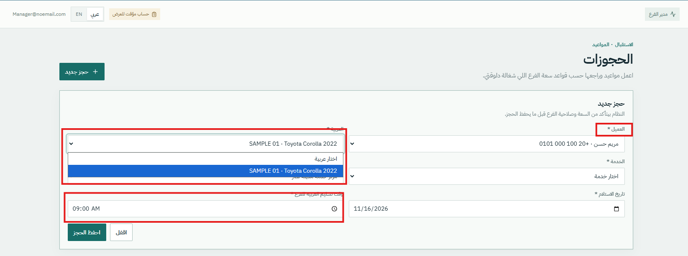
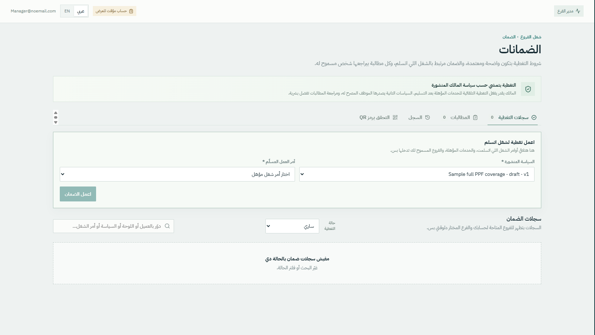
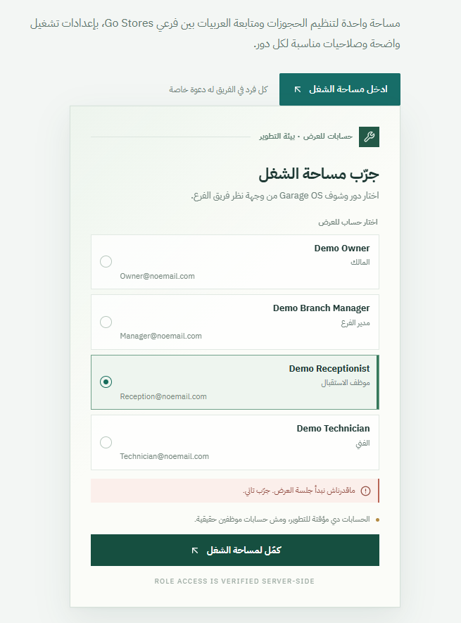
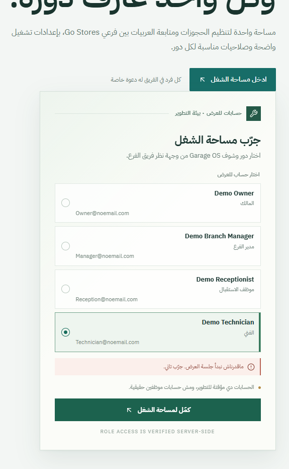

# Garage OS — UI Test Report

**Ongoing tracking:** Use the [Phase 1 issues tracker](PHASE_1_ISSUES_TRACKER.md) for technical approaches, implementation progress, retests, and new issues. This report preserves the original UI observations.

**Original test date:** 14 November 2026  
**Original author:** Mohammed Maher  
**Markdown conversion:** 15 November 2026  
**Source:** [Original nine-page PDF](Garage_OS_UI_Test_Report.pdf)  
**Related report:** [Repository code review](REPOSITORY_CODE_REVIEW.md).

This is a cleaned Markdown conversion of the supplied UI report. It preserves all 15 issue IDs, original severity ratings, open statuses, and nine screenshots. Page furniture, broken table rows, and PDF text-order artifacts have been removed. No UI retest or issue resolution is implied. Screenshots were extracted from the PDF; observations and release conclusions below belong to the original test session.

## Summary

**Original result: not ready to release.** The report identifies 15 issues across nine screenshots. Three high-severity issues are classified as blockers: demo login fails for Receptionist and Technician, and the warranty form offers a draft policy under “Published policy.”

| Test context | Details |
|---|---|
| Build | Development build with demo accounts |
| Interface | Arabic, right-to-left |
| Browser | Desktop browser; browser name/version not specified |
| Main role | Demo Branch Manager |
| Scope | Landing and demo login, account-not-assigned page, workshop board, technician assignment, bookings list, new booking form, and warranties |
| Limitation | Receptionist and Technician could not be tested further because their demo sessions failed |

| Severity | Count |
|---|---:|
| High | 3 |
| Medium | 4 |
| Low | 8 |
| **Total** | **15** |

## Issue register

All statuses are the statuses reported in the original PDF, not independently verified current statuses.

| ID | Area | Reported issue | Severity | Status | Evidence |
|---|---|---|---|---|---|
| GO-01 | Demo login | Receptionist demo account fails to start a session | High | Open | [Screenshot 8](#screenshot-8--receptionist-login-error) |
| GO-02 | Demo login | Technician demo account fails to start a session | High | Open | [Screenshot 9](#screenshot-9--technician-login-error) |
| GO-03 | Warranties | “Published policy” field offers a draft policy | High | Open | [Screenshot 7](#screenshot-7--warranties) |
| GO-04 | Account access | “Account not assigned” page is English-only in the Arabic UI | Medium | Open | [Screenshot 2](#screenshot-2--account-not-assigned) |
| GO-05 | Workshop board | Stage filter has two near-identical Arabic options for received and delivered | Medium | Open | [Screenshot 3](#screenshot-3--workshop-stage-filter) |
| GO-06 | Technician assignment | “Update owner” button is disabled with no explanation | Medium | Open | [Screenshot 4](#screenshot-4--technician-assignment) |
| GO-07 | New booking | Vehicle dropdown covers and clips field labels | Medium | Open | [Screenshot 6](#screenshot-6--new-booking-form) |
| GO-08 | Landing | Header brand block is flagged for alignment | Low | Open | [Screenshot 1](#screenshot-1--landing-page) |
| GO-09 | Landing | “Access model” card is rotated and looks skewed | Low | Open | [Screenshot 1](#screenshot-1--landing-page) |
| GO-10 | Landing | Default dark scrollbar clashes with the light theme | Low | Open | [Screenshot 1](#screenshot-1--landing-page) |
| GO-11 | Bookings list | Times use Latin digits while dates use Arabic-Indic digits; time is misaligned | Low | Open | [Screenshot 5](#screenshot-5--bookings-list) |
| GO-12 | New booking | Required asterisk on the customer label is flagged for placement | Low | Open | [Screenshot 6](#screenshot-6--new-booking-form) |
| GO-13 | New booking | Time field shows “09:00 AM” in English | Low | Open | [Screenshot 6](#screenshot-6--new-booking-form) |
| GO-14 | Warranties | Tab bar shows stray scroll arrows | Low | Open | [Screenshot 7](#screenshot-7--warranties) |
| GO-15 | Warranties | “Create warranty” button is disabled with no hint | Low | Open | [Screenshot 7](#screenshot-7--warranties) |

## Findings and screenshot evidence

### Screenshot 1 — Landing page

**Issues:** GO-08, GO-09, GO-10.  
**Source:** PDF page 3; description begins on page 2.

The original report flags three visual issues in red:

- Check the alignment of the “Garage OS · GO STORES · EGYPT” brand block against the header divider.
- The rotated “Access model” card reads as a rendering problem to the tester.
- The default dark scrollbar clashes with the light page.

### Screenshot 2 — Account not assigned

**Issue:** GO-04.  
**Source:** PDF page 3.

The page is entirely in English while the rest of the application is in Arabic. It offers only “Sign out,” with no route back to the demo accounts.

### Screenshot 3 — Workshop stage filter

**Issue:** GO-05.  
**Source:** PDF page 4.

The filter lists “اتسلمت” and “اتسلّمت,” differing only by a shadda. The tester could not clearly distinguish received from delivered. The dropdown also uses a native browser list with a bright blue selection highlight.

### Screenshot 4 — Technician assignment

**Issue:** GO-06.  
**Source:** PDF page 5.

The “حدّث المسؤول” action, described as “Update owner” in the original issue register, stays disabled before a technician is selected, without explaining why. Its low contrast also makes the label difficult to read.

### Screenshot 5 — Bookings list

**Issue:** GO-11.  
**Source:** PDF page 5.

Dates use Arabic-Indic digits, while times use Latin digits, such as `10:00`. The time is also offset below and to the left of its date.

### Screenshot 6 — New booking form

**Issues:** GO-07, GO-12, GO-13.  
**Source:** PDF page 6; description on page 5.

The open vehicle dropdown overlaps the next row, and text from the field behind it shows through below an option. The vehicle label and delivery-time label are clipped. The time field displays `09:00 AM` in English, and the required marker beside the customer label is flagged for placement.

### Screenshot 7 — Warranties

**Issues:** GO-03, GO-14, GO-15.  
**Source:** PDF page 6.

The “السياسة المنشورة” (“Published policy”) field displays `Sample full PPF coverage · draft · v1`. The original report leaves the cause open: either draft policies appear in the published list or the field label is incorrect. This screenshot alone does not establish that the server permits issuing a warranty under a draft policy.

The tab bar also displays stray up/down scroll arrows. The “اعمل الضمان” (“Create warranty”) button is disabled without a hint explaining the missing prerequisite.

### Screenshot 8 — Receptionist login error

**Issue:** GO-01.  
**Source:** PDF page 7; description on page 6.

Selecting Demo Receptionist and pressing “كمّل لمساحة الشغل” shows “ماقدرناش نبدأ جلسة العرض” (“Could not start the demo session”). The Branch Manager session worked during the same test, so the report describes the failure as apparently role-specific. No backend cause was established.

### Screenshot 9 — Technician login error

**Issue:** GO-02.  
**Source:** PDF page 8; description on page 6.

Selecting Demo Technician and pressing the same continue action produces the same demo-session error. Further testing of this role was blocked.

## Original recommendations, cleaned for readability

1. Fix Receptionist and Technician demo login first (GO-01, GO-02), then retest both roles end to end.
2. Exclude draft policies from the published-policy list (GO-03), or clarify the field if drafts are intentionally displayed. Confirm the intended policy workflow before changing behavior.
3. Localize every screen, including “Account not assigned” and the time picker. Use a consistent digit system for dates and times (GO-04, GO-11, GO-13).
4. Make received and delivered stage labels distinguishable by wording rather than diacritics alone (GO-05).
5. Explain disabled actions with nearby prerequisite hints (GO-06, GO-15).
6. Group layout corrections into a styling pass (GO-07–GO-10, GO-12, GO-14), then check RTL layouts at 375, 768, 1024, and 1440 px.

After fixes, run a full regression using all four demo roles: Owner, Branch Manager, Receptionist, and Technician. No such follow-up run is recorded in this converted report.
